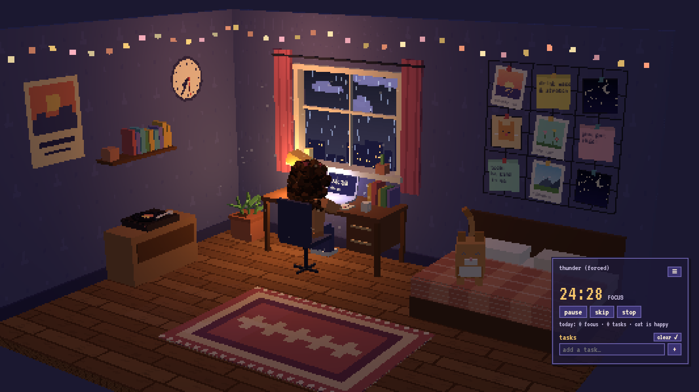

# 🌙 Cozy Pixel Room

**your desktop, but it's a tiny lofi bedroom you actually live in.**

## why this exists
I was tired of generic wallpapers. Same mountain, same gradient, same "aesthetic" photo everyone else has. My friends kept looking at my screen and going *"bro your desktop looks so boring."* Fair.

And as an avid fan of [Lofi Girl](https://www.youtube.com/@LofiGirl) (yes, the one studying by the window with the cat, for what feels like a decade), I didn't want to just *look* at that room. I wanted to sit in it. So I built one that lives on my desktop and actually does stuff.

## what it does
- 🌧 **the window shows your real weather.** rain outside? it rains in the room. open the window and you hear it. drag the curtains shut and the room gets dark.
- 🍅 **focus timer with a study buddy.** click the tomato on the desk and she walks in and studies with you. on break she leans back. stop and she leaves.
- 📝 **tasks crumple into the bin.** finish a task and the paper scrunches up on the desk and arcs into the basket (with a satisfying crumple sound).
- 🌱 **a plant that grows when you work** and wilts when you don't.
- 🐱 **a cat with feelings.** happy after you work, judgy when you've been idle, napping curled up in bed, asleep at night. pet it by wiggling your mouse over it. click it to wake it up or open Claude. it talks in little speech bubbles.
- 🗓 **your Google Calendar + Outlook** on a paper calendar that tears off at midnight.
- 📌 **your Windows sticky notes** pinned to a board in the room.
- 🖼 **your photos** on the wall grid, or straight from a Google Photos album. open the top desk drawer for a random memory.
- 🐟 **cat treats** in the bottom drawer. shake the tin. the cat will forgive you.
- 🎵 **a record player + crate** with built-in lofi, late-night jazz, rain, and your Spotify playlists. the room lights pulse to whatever you're playing.
- 🎧 **Spotify remote.** playing Spotify (the app, or open.spotify.com in your browser)? the record player becomes play/pause, and the crate shows what's on with ⏮ ⏯ ⏭. no login needed: it uses Windows' own media controls.
- 🧹 **sweep your desktop icons under the rug.** literally. lift the rug to find them.
- 🛏 **bed = wind-down mode.** lights dim, lamp off, brown noise, the cat sleeps, and a card shows tomorrow's first event.
- 🖥🖥 **two monitors?** both stay in sync. do something on one screen and the other just quietly updates.

## get it running (5 minutes)
You need Windows 10/11 and [Lively Wallpaper](https://www.rocksdanister.com/lively/) (free, on the Microsoft Store).

1. Download this repo (green **Code** button → **Download ZIP**, or `git clone`) and keep the folder somewhere it won't get deleted.
2. Lively → **Add Wallpaper** (+) → pick `index.html`.
3. Lively → Settings → Wallpaper → **Wallpaper input: Mouse & keyboard** (so you can click things and type tasks).
4. Double-click `helper/start-helper.cmd` (lets the room hide icons, read sticky notes, open links, load your calendar; [details](#the-helper)). `helper/install-startup.cmd` makes it start with Windows.
5. Right-click the wallpaper in Lively → **Customise** for your location, timer lengths, calendar links and photo album.

## make it yours
1. Copy `assets/manifest.example.js` to `assets/manifest.js` (git-ignored, so your stuff stays private) and fill in:
   - `wall`: 9 slots for photos, polaroids and notes (images go in `assets/photos/`)
   - `records`: your Spotify playlists for the crate
   - `books`: up to 10 bookmarks for the shelf (sites, `spotify:` links or folders)
   - `music`: your own mp3s in `assets/music/` (optional)
2. Added images? Run `python tools/embed_assets.py`.
3. **Google Photos:** make an album, Share → "anyone with the link", paste the link into Customise.
4. **Calendars:** paste into Customise:
   - Google Calendar → Settings → your calendar → **Secret address in iCal format**
   - Outlook → Settings → Calendar → Shared calendars → **Publish a calendar** → ICS link (personal: outlook.live.com, work/school: outlook.office.com)

   These links are private keys to your calendar, so never share or commit them.

## ✨ or let Claude do it: the `claude-skill` folder
Don't feel like editing files? The [`claude-skill/cozy-room`](claude-skill/cozy-room/SKILL.md) folder is a skill for [Claude Code](https://claude.com/claude-code) that knows how this room is built. It covers setup, connecting Google Calendar and Outlook step by step, your photos and playlists, and adding brand new objects to the room.

**Install it:** copy the `cozy-room` folder into `~/.claude/skills/` (all your projects) or into `.claude/skills/` inside this repo (just this one). Then open Claude Code here and say things like:
- *"set up my room and connect my Google Calendar and Outlook"*
- *"put my dog on the bed instead of the cat"*
- *"add a guitar in the corner that opens my practice playlist"*
- *"make the room pastel pink"*

## the helper
A wallpaper can't touch your desktop or start apps, so a small local helper does that:
- **Run once:** double-click `helper/start-helper.cmd`
- **Start automatically at login:** double-click `helper/install-startup.cmd`. To undo it, delete `Cozy Room Helper.lnk` from `shell:startup`.

It listens only on `127.0.0.1:38917` and runs a fixed set of actions. Every request needs the token in `helper/token.js` (created on first run), so other web pages can't use it. It:
- hides/shows desktop icons, and tucks single icons under the rug (moves them to `%USERPROFILE%\CozyRug` and back)
- reads Sticky Notes (from a copy of its database; it never writes to it) and opens notes through the app
- opens links from the bookshelf and records, launches Claude, reads Windows location, fetches your calendar feed
- runs the cat's morning brief once a day (see below)

The port isn't 47823 because WSL's mirrored networking reserves that range.

## what's clickable
| Thing | Does |
|---|---|
| **Rug** | **click**: a wave sweeps all desktop icons under it (click again: they hop out). **drag**: the rug folds back as far as you pull and stays, showing the real icons lying underneath; click one to open it. **drop a desktop icon onto the rug**: that one file gets tucked under (a lump appears); lift the rug and drag it off to put it back on the desktop |
| Record player | play / pause. Spins only while music plays, including Spotify or any other system audio |
| **Record crate** (floor, by the cabinet) | pick music: lofi beats, late-night jazz, rain on the window, plus your Spotify playlists (`records` in `assets/manifest.js`) |
| Lights | follow the music: the playing artist's genre (looked up on MusicBrainz) picks the colours (pop = red/blue, indie/folk = warm yellow, lofi = purple, electronic = neon…) and they pulse on the beat. Toggle in Customise |
| **Sticky note board** | mirrors the Windows Sticky Notes app. Click a note to open it there; the "+" pad starts a new note |
| **Window** | click to open/close: weather sounds come in (rain + thunder, wind, birds by day, crickets and the city at night). **Drag a curtain** to draw it; the room darkens. Click a curtain to open/close both |
| **Bookshelf** | each book is a bookmark (`books` in `assets/manifest.js`). Hover to read, click to open |
| **Wall calendar** | today's date + events from Google Calendar and/or Outlook (Customise → Google Calendar link: Settings → your calendar → "Secret address in iCal format"; Outlook calendar link: Settings → Calendar → Shared calendars → Publish a calendar → ICS). Click for today/tomorrow. The page tears off at midnight |
| **Bed** | wind-down mode: room dims, lamp off, music fades, brown noise, the cat sleeps, a card shows tomorrow's first event. Click again (or "wake up") to come back |
| **Paper bin** | every finished task scrunches up on the desk (with a crumple sound) and arcs into the bin. Click for what you got done this week |
| Cat | click: opens the Claude app, or **wakes it up** if it's asleep. **Wiggle the mouse over it** to pet it (purrs, hearts). Talks in little speech bubbles. Mood: happy after recent work, idle after a while, **curled up napping** halfway to angry, **angry** after 90 min of nothing, asleep at night and in wind-down |
| **Desk drawers** | top: **memories**, a photo from your Google Photos album pops out as a polaroid (flip through them). bottom: **cat treats**, the tin rattles and a treat flies to the cat |
| **Letter on the bed** | the cat's message box. Bounces when there's something new: your **morning brief** or a due **reminder**. Add reminders there ("in 20m", "6pm") |
| Tomato timer (desk) | start / pause a focus session. The girl walks in and studies; on break she leans back; on stop she leaves |
| Laptop | show / hide the tasks panel. The screen mirrors the timer |
| Plant | each finished task: +water. Each finished focus session: +more. Wilts if neglected |
| Wall grid | photos and polaroids open in a lightbox; notes are editable |
| Clock / lamp | real time / lamp on-off |

## morning brief (optional, needs Claude Code in WSL)
Click "write one now" in the cat's letter, or create an empty file `%LOCALAPPDATA%\CozyRoom\auto-brief.on` to have it run by itself after 7am, the first time the PC is on. The helper runs Claude Code (`claude -p` in WSL), using your `morning` skill if you have one. Claude reads your connected tools (Gmail, Drive…) and writes:
- `%LOCALAPPDATA%\CozyRoom\brief\brief-YYYY-MM-DD.html`: the full page ("open full brief")
- `brief-YYYY-MM-DD.json`: the short version the cat shows

It runs at most once a day automatically, is read-only, and doesn't send or publish anything. Logs: `log-YYYY-MM-DD.txt` in the same folder. Each run uses some of your Claude usage.

## testing in a browser
Open `index.html` directly. URL parameters:
- `?hour=21` fakes the time of day · `?weather=rain|snow|fog|thunder|cloud|clear` forces the weather · `?mood=angry|happy|idle|sleeping` forces the cat
- `?debug` makes one minute last one second (timer, plant and cat moods move quickly)
- `?debug&demo=focus` starts a focus session · `?demo=peel` lifts the rug · `?demo=crumple` throws two paper balls · `?demo=drawers` / `?demo=treat` open the drawers
- `?debug&selftest` runs the end-to-end self-test (49 checks; results in `window.SELFTEST` and the console as `SELFTEST PASS/FAIL`). Links and apps are stubbed; the rug's hide/show runs for real and is put back.

## two monitors
Set Lively's wallpaper arrangement to **Duplicate** (Lively → the monitor icon). Each screen runs its own copy of the room in its own throwaway browser profile, so the room's state lives in the helper (`%LOCALAPPDATA%\CozyRoom\room-state.json`) instead of the browser. That also means it survives Lively restarts.
- The screen you're using animates; the other one quietly snaps to the same state within a second (window, curtains, lamp, focus timer, tasks, reminders, plant, rug, wall notes, paper bin).
- Lively plays audio from one screen only, so sounds and music you start on the silent screen are replayed on the other one.
- Without the helper running, each screen keeps its own state.
- Test: run `helper\cozy-helper.ps1 -Port 38999 -Data C:\Temp\cozysync -Test`, then open `tools/synctest.html` (two copies side by side; the right one acts, the left one logs `SYNCTEST` lines).

## known limits
- Without the helper, the cat falls back to `claude://`, which Lively's browser may block, and the rug, sticky notes, links and brief don't work.
- Tucking single icons under the rug works for your own desktop files, not the shared "Public" desktop ones (moving those needs admin).
- Sticky Notes has no API: the helper reads its database copy and drives the app's own buttons. A future Sticky Notes update could change that.
- "Unproductive" means no tasks or focus sessions. Lively can't see which apps you're using.
- Location comes from Windows location services via the helper (precise), then the browser, then an IP lookup (often only country-level). If it's wrong, turn on Settings → Privacy & security → Location, or set latitude/longitude in Customise.

## privacy
Everything runs on your PC. The helper listens only on `127.0.0.1`, needs a random token that only the wallpaper page has, and runs a fixed list of actions (it can't run arbitrary commands). Network calls: weather (Open-Meteo), an approximate location lookup if Windows location is off (ipwho.is, geojs.io, BigDataCloud for the city name), music genres (MusicBrainz), and the calendar/photo links you paste in.

## contributing
Made a cuter room? A new pet? Fixed something? PRs and issues are very welcome. Run `index.html?debug&selftest` before sending changes. And if you set it up, I'd love to see your desk 🐾

## license
MIT (see `LICENSE`). three.js is MIT, © three.js authors.
